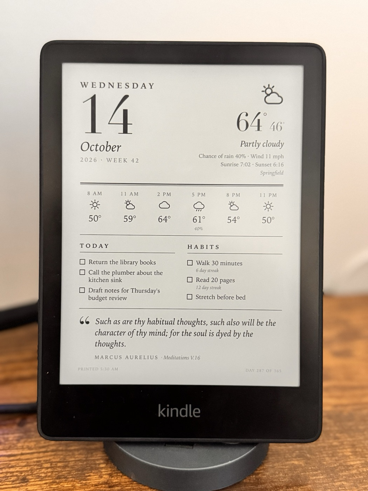
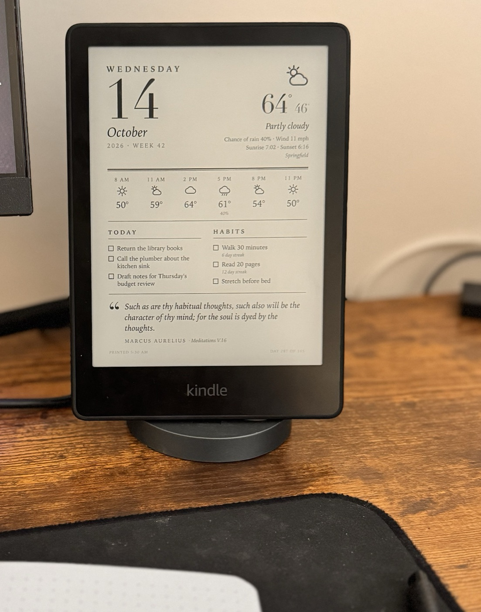
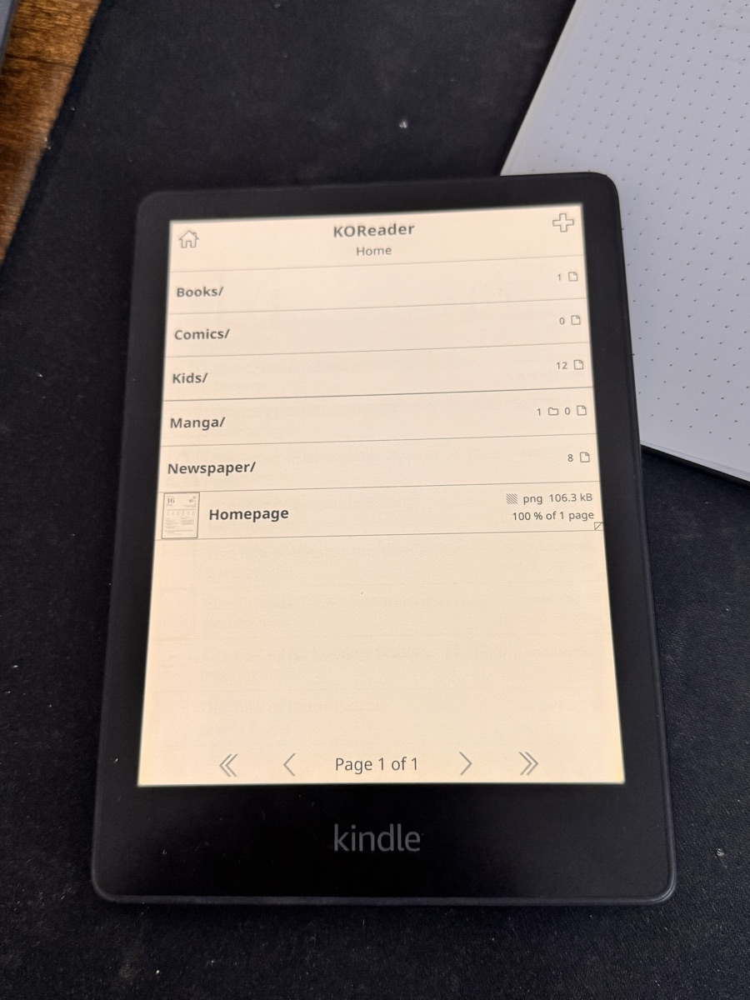
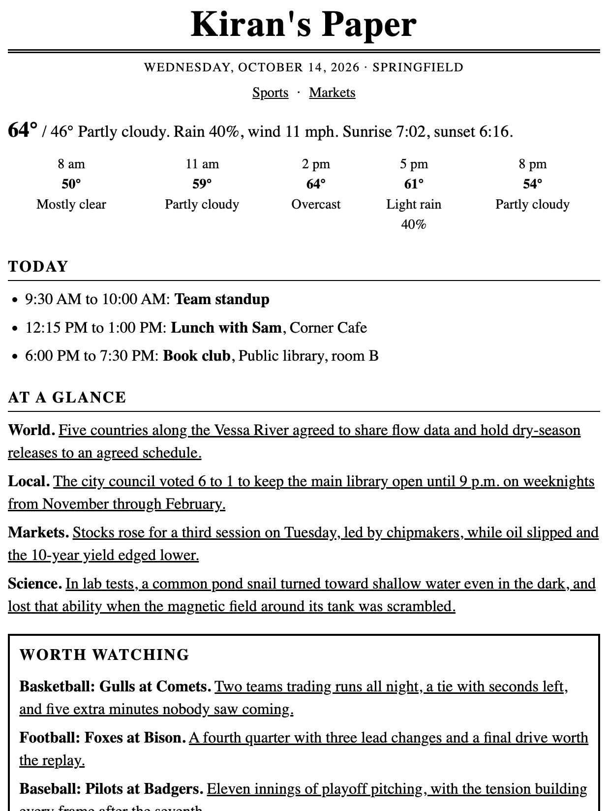
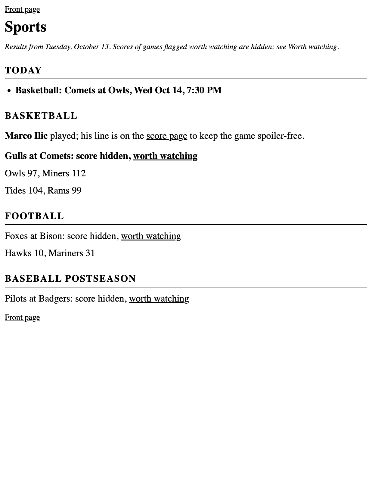
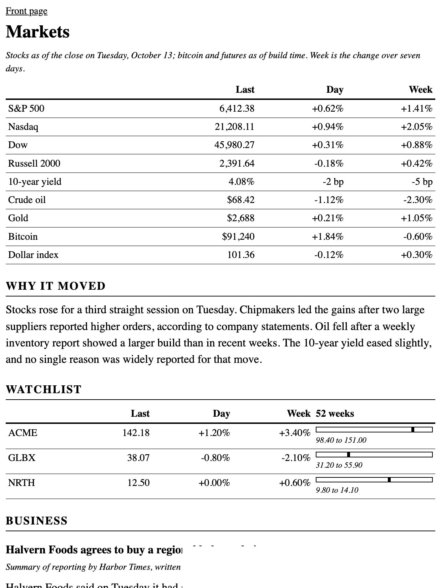
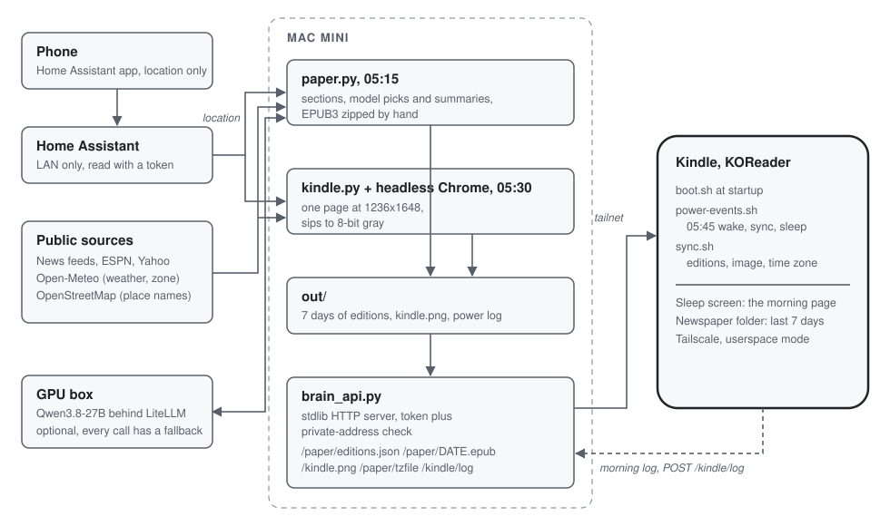

# Kiran's Paper

I wanted my Kindle to be more than a book. Now it does two things: when it's asleep, the screen shows a one-page dashboard for the day, and every morning it gets a small newspaper made just for me.

<p align="center">
  
</p>

> The photos are the real device, with demo content on the screen. Everything else in here is rendered from made-up data.

It's a 2021 Kindle Paperwhite running [KOReader](https://koreader.rocks). A Mac mini at home builds both pages with about 3,000 lines of plain Python. Nothing is on the public internet.

## The dashboard

E-ink keeps an image on screen without using power, so the sleep screen is the perfect place for a daily summary. Mine has the date, the weather where I am, my reminders, my work reminders, and a quote from someone worth reading. It gets rebuilt every morning before I'm up.

<p align="center">
  
  
</p>

When I pick it up, it's a normal e-reader. The home folder has one entry per kind of reading, plus the newspaper and the dashboard.

## The newspaper



Each edition is a real EPUB, so I can tap through it like a book. The front page works like a homepage: one line per story, tap it to read the rest.

- **World:** one story, the one that several big news outlets are all leading with.
- **Local:** the most important civic story wherever my phone is that day.
- **Markets:** the numbers and a short summary of why things moved. It's not allowed to give advice, and a check after the AI step enforces that.
- **Science:** one new finding.
- **Sports:** scores, plus a "worth watching" box for games that were actually good. Those scores are hidden behind a link, so I can watch the replay without knowing the result.

A local AI model on a home server writes the summaries. If it's busy or offline, the paper still comes out, just plainer. Sections with nothing to say that day are left out.

<br clear="right">

<p align="center">
  
  
</p>

## How it works

<p align="center">
  
</p>

- **5:15 am:** the Mac mini builds the newspaper.
- **5:30 am:** it renders the dashboard to an image the exact size of the Kindle's screen.
- **5:45 am:** the Kindle wakes itself up, downloads both, and goes back to sleep. That takes about a minute.

The weather, local news and even the Kindle's clock follow my phone's location, so nothing changes by hand when I travel. The Kindle reaches the mini over Tailscale from anywhere.

Getting a sleeping Kindle to wake up on schedule was the trickiest part. The short version is in [docs/power.md](docs/power.md).

## What I learned

- **A sleeping device runs nothing.** My first version refreshed every hour, but those timers pause while the Kindle sleeps, so the dashboard was always a day old. A hardware wake-up alarm fixed it.
- **Waking up isn't the same as being awake.** After the alarm, the Kindle comes back half asleep with WiFi off, so the script has to wake it fully before it can sync.
- **Keep the AI optional.** The GPU it runs on is shared, and one day another app had hogged its memory. Because every AI step has a fallback, the paper still showed up.

## Try it

The demo needs only Python 3.9 or newer:

```bash
python3 server/paper.py build --demo
```

That builds a sample edition from made-up stories into `server/out/demo/`. To run it for real, copy `config/brain-api.env.example`, fill it in, and see [docs/architecture.md](docs/architecture.md). The dashboard render currently needs macOS.

## More

- [docs/architecture.md](docs/architecture.md): the files, the daily timeline, the endpoints
- [docs/decisions.md](docs/decisions.md): why it's built the way it is
- [docs/power.md](docs/power.md): the morning wake-up in detail

MIT license.
