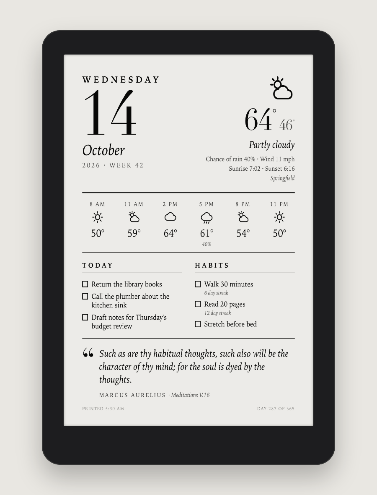
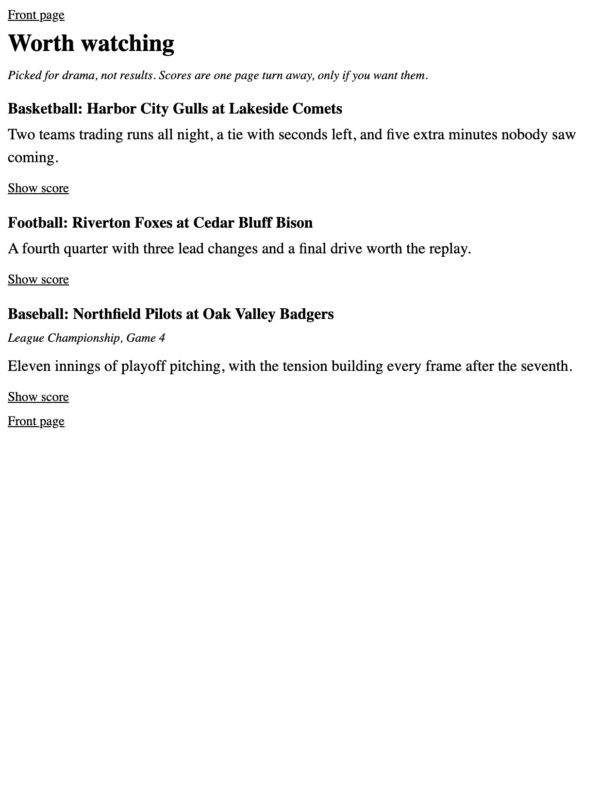

# Kiran's Paper

A Kindle that does two quiet things. Every morning it gets a small newspaper, built overnight on a computer at home, with an optional local language model writing the summaries. And when it's asleep, the sleep screen is a one-page dashboard for the day: date, weather, tasks, a quote. E-ink holds that picture at zero power, so it sits on the desk like a printed page.

<p align="center">
  
</p>

<!-- photo coming: media/photo-desk.jpg (the real device on the desk) -->
> Photo of the real thing on the desk: coming. Every image in this README is rendered from made-up demo data by [`tools/render-media.sh`](tools/render-media.sh), using the same pipeline as production.

The device is a 2021 Kindle Paperwhite running [KOReader](https://koreader.rocks). The server side is about 3,000 lines of standard-library Python on a Mac mini. Nothing is exposed to the internet.

## What's in an edition

| | |
|---|---|
|  | **The front page is a homepage.** Masthead, date and the town the owner is in, the weather, today's calendar, and one sentence per story. Tap a sentence and you're in the article; every page links back. KOReader follows EPUB internal links well, which is what makes this work. |

The sections, each of which disappears on a day it has nothing to say:

- **World.** One story. The build pulls the top items from three wire and broadcast feeds and picks the one all of them are covering. If three newsrooms independently lead with it, it probably matters, and the overlap strips out a lot of single-outlet framing. The model writes a flat summary and credits the sources.
- **Local.** Whatever county the owner's phone is in today. No town is written down anywhere in the code. A news search for that county and city over the last day, then the model picks the most significant civic story and skips crime blotter, obituaries and ads.
- **Markets.** Major indexes, the 10-year, oil, gold, bitcoin and the dollar, with day and week changes, an optional watchlist with 52-week range bars, and one paragraph on why things moved.
- **Science.** One new finding, not an explainer.
- **Sports**, with a spoiler-free **Worth watching** box. More on that below.
- Optional **Reddit** (your private feed) and **New in the library** (a Plex server), both hidden unless configured.

<p align="center">
  
  
  
</p>

### Two guardrails I don't leave to the model

**Markets never gives advice.** The prompt says report only. That's not enough on its own, so a regex checks the result for anything that reads like buy, sell, hold, a price target or a forecast. If it trips, the paragraph is dropped and the front page gets a sentence built from the numbers instead.

**Sports never spoils a good game.** Every finished game gets a watchability score: a close margin, overtime or extra innings, lead changes, a big comeback, playoff stakes, a monster stat line. Games that clear the bar (a lower bar for favorite teams) get one line from the model about why they're worth a replay, checked against a list of giveaway words like *won*, *beat* and *clinched*, and any number that looks like a score. Their scores are then removed from every page in the edition. The real result sits on a separate page marked `linear="no"` in the EPUB spine, so page turns never land on it. The only way in is a "Show score" link. News headlines that name a flagged team are skipped too, so the result can't leak through the world or local pages.

## How it works

<p align="center">
  
</p>

| Time (Eastern) | Where | What happens |
|---|---|---|
| 05:15 | Mac mini | `paper.py` gathers every section, calls the model inside a time budget, writes `YYYY-MM-DD.epub`, prunes anything older than seven days |
| 05:30 | Mac mini | headless Chrome screenshots the morning page at 1236x1648, `sips` converts it to 8-bit gray |
| 05:45 | Kindle | the reader wakes on its own alarm, syncs both, posts its log home, and goes back to sleep |

A few details I'm happy with:

- **No dependencies.** Everything is Python's standard library plus tools macOS ships. The EPUB is assembled by hand with `zipfile` (the `mimetype` entry first and stored uncompressed, a nav document, an NCX for older readers, a spine) and passes `epubcheck` with no errors or warnings. Every page is parsed as XML at build time; one that fails is replaced with a stub instead of breaking the book.
- **The model is optional.** Summaries and picks come from Qwen3.8-27B on a GPU box at home, behind a LiteLLM gateway. Every job has a deterministic fallback (first item, feed summary, a templated line), and after three failed calls in a row the build stops asking. With the GPU busy, the paper still comes out in about 12 seconds instead of 70, just plainer.
- **Location follows a phone.** The Home Assistant app reports where the phone is. The server reverse geocodes that with OpenStreetMap (cached, at most one request a second, logs name the city and never the coordinates), and the weather, the local news and the Kindle's clock all follow it.
- **Full text only where it's offered.** Articles are extracted with a small readability-style parser on `html.parser`. Some publishers block automated readers, and those stories fall back to the headline and feed summary. No paywall tricks.
- **Private by default.** The server answers only private addresses that also present a token. Away from home, the Kindle reaches it over a private Tailscale tailnet.

More in [docs/architecture.md](docs/architecture.md) and [docs/decisions.md](docs/decisions.md).

## The 05:45 wake

This was the fun part, and it gets [its own page](docs/power.md). The short version:

A sleeping Kindle doesn't run anything, so my first version (a sync loop that ran every hour) simply paused overnight and the sleep screen kept showing yesterday. The fix is to ask the power daemon for a real-time-clock alarm. A small script on the reader listens to power events. When the device is about to suspend, it sets `rtcWakeup` for the next 05:45. When it wakes from that alarm, it has to deal with a surprise: the Kindle comes back in a half-awake screensaver state where WiFi won't come up. So the script tells powerd to wake up fully, turns WiFi back on (KOReader switches it off at sleep), waits for the server, syncs, and posts the tail of its log home. Then it presses the power button in software, which makes KOReader draw a fresh sleep screen with the new dashboard and suspend again.

The whole thing takes under a minute. If someone picks the Kindle up and presses the button instead, the script can tell (wrong state, or too far from the alarm time), syncs in the background, and never puts the device back to sleep in their hands.

The clock needed fixing too. The device has no zoneinfo, so its local time file pointed at nothing and it ran on UTC. The server now looks up the zone for the phone's location and serves the compiled zoneinfo file at `/paper/tzfile`; the sync script installs it whenever the zone changes.

## Things that broke along the way

- **Every model call failed for a day.** An image generation app on the same GPU had been holding 12 GB of VRAM for three weeks, so the model couldn't load. The fallbacks did their job and nobody noticed except the footer, which counts successful model calls. Freeing that memory is now the first thing I check.
- **The sleep screen was a day old.** The hourly sync loop is just `sleep 3600`, and `sleep` stops counting while the device is suspended. That's what led to the alarm design above.
- **powerd doesn't say things once.** `readyToSuspend` fires every few seconds while the daemon waits to sleep. My first listener treated it as a one-off, re-armed the alarm on every tick and flooded its own log. Now a busy flag turns those ticks into `deferSuspend` calls while a refresh runs, and a changed alarm is the only thing that gets logged.
- **A shell read half of a new script.** `sh` reads a script as it runs it, so overwriting a running script in place handed it a mix of old and new lines. Updates are now written to a temp file and renamed over the old one.
- **A kill command killed my own session.** Restarting the listener with a pattern match over SSH also matched the SSH command carrying that pattern. [`restart-listener.sh`](device/restart-listener.sh) walks `/proc` and compares exact command lines instead.
- **A tailnet node vanished.** Tailscale node keys expire, and one machine in the chain had been booted into another OS long enough to miss the renewal. Key expiry is off for the always-on nodes now.
- **The calendar stayed empty.** macOS wouldn't let the background job read Calendar until a privacy prompt was approved, and `launchd` jobs don't show you that prompt. Running the job once by hand while watching the screen got the dialog to appear.
- **Calendar emoji.** Subscribed sports calendars put emoji in event titles, which the Kindle's fonts render as boxes. They're stripped.
- **"Thursday" on a Friday.** The markets paragraph once named the wrong day because the model took it from a headline. The prompt now supplies the weekday of the close and says to use only that.

## Repo layout

```
server/      paper.py and its sources, kindle.py (morning page), brain_api.py (HTTP server), build scripts
device/      the shell scripts that run on the reader: boot, sync, the daily wake
examples/    made-up fixtures for the demo edition and the demo morning page
tools/       render-media.sh, which rebuilds everything in media/
media/       screenshots from demo data, the architecture diagram
launchd/     example jobs for the server, the 05:15 build and the 05:30 render
config/      example environment file (names and placeholders only)
docs/        architecture, design decisions, the wake design
```

## Run it yourself

The demo needs nothing but Python 3.9 or newer:

```bash
python3 server/paper.py build --demo          # made-up edition, no network, lands in server/out/demo/
python3 server/kindle.py --demo examples/demo-morning.json > /tmp/morning.html
tools/render-media.sh                         # macOS with Chrome: rebuild media/ from the fixtures
```

For a real edition:

```bash
mkdir -p ~/.config/brain-api
cp config/brain-api.env.example ~/.config/brain-api/brain-api.env   # fill it in, chmod 600
set -a; source ~/.config/brain-api/brain-api.env; set +a
python3 server/paper.py build --no-llm        # or leave off --no-llm if LLM_URL and LLM_KEY are set
python3 server/brain_api.py                   # then open http://localhost:8484/paper?key=YOUR_HABIT_TOKEN
```

The morning page and the calendar are macOS-specific (`sips`, `icalBuddy`, Chrome); the paper itself runs anywhere Python does. Favorite teams, player and soccer club, the watchlist and the paper's name are all environment variables. The `launchd/` plists schedule the three jobs.

On the reader, the scripts in `device/` expect KOReader in `/mnt/us/koreader`, the scripts in `/mnt/us/paper` with a `config.sh` made from [`config.example.sh`](device/config.example.sh), and some way to run `boot.sh` at startup. How you get a shell script to run on your particular e-reader is up to you and out of scope here.

## License

MIT, see [LICENSE](LICENSE).
